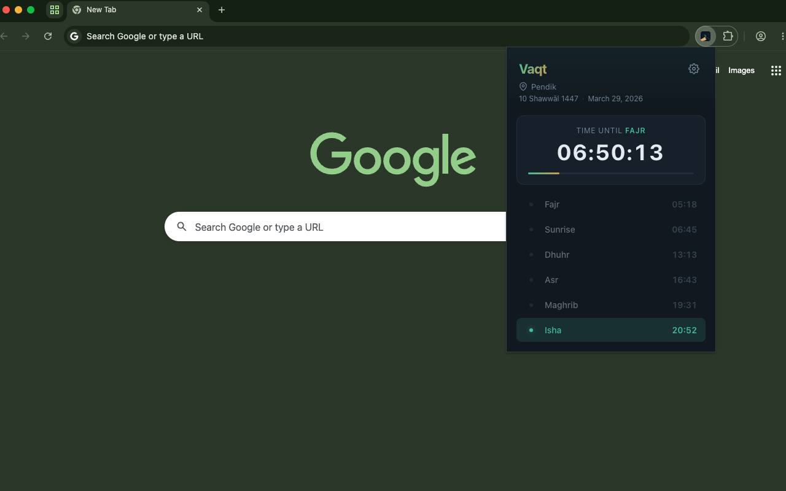
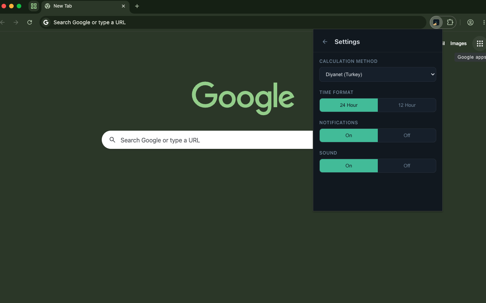

# Vaqt - Prayer Times

  

  A sleek, minimal browser extension that displays daily prayer times based on your location.

  
  

## Screenshots

| Prayer Times | Settings |
|:---:|:---:|
|  |  |

## Features

- **Location-based prayer times** — automatically detects your location to show accurate times
- **City search** — pick any city by hand instead of sharing your location, with times and countdown in that city's own time zone
- **Live countdown** — real-time countdown with progress bar to the next prayer
- **6 prayer times** — Fajr, Sunrise, Dhuhr, Asr, Maghrib, Isha
- **Hijri & Gregorian dates** — both calendars displayed side by side
- **Notifications** — get notified when it's time for prayer (with sound toggle)
- **6 calculation methods** — Diyanet, ISNA, MWL, Umm Al-Qura, Egyptian, Karachi
- **12/24 hour format** — switch between time formats
- **Remembers your location** — opens straight to your times without asking again
- **No account needed** — works instantly, no sign-up required
- **Privacy focused** — no servers of its own, no tracking

## Install

## Settings

| Setting | Options | Default |
|---------|---------|---------|
| Location | Current location / a city you search for | Current location |
| Calculation Method | Diyanet, ISNA, MWL, Umm Al-Qura, Egyptian, Karachi | Diyanet |
| Time Format | 24 Hour / 12 Hour | 24 Hour |
| Notifications | On / Off | On |
| Sound | On / Off | On |

## Troubleshooting

### Location not working?

Vaqt needs location permission to show accurate prayer times.

**In Chrome:**
1. Go to `chrome://extensions` → find Vaqt → click **Details**
2. Click **Site settings** → set **Location** to **Allow**

**On macOS:**
System Settings → Privacy & Security → Location Services → enable Chrome

**On Windows:**
Settings → Privacy → Location → enable for your browser

## Privacy

Vaqt only uses your location to calculate prayer times. Your settings are stored locally in your browser, and Vaqt has no servers of its own. To get the times, your coordinates are sent to the [Aladhan API](https://aladhan.com/prayer-times-api); to show your city name or search for a city, your coordinates or the city you typed are sent to [OpenStreetMap Nominatim](https://nominatim.org/). See the [Privacy Policy](privacy.html) for details.

## Development

No build step. To run it locally:

1. Open `chrome://extensions` and turn on **Developer mode**
2. Click **Load unpacked** and select this folder
3. After changing a file, click the reload icon on the Vaqt card

## Credits

Prayer times from the [Aladhan API](https://aladhan.com/prayer-times-api). Place names © [OpenStreetMap contributors](https://www.openstreetmap.org/copyright).

## License

[MIT](LICENSE)
