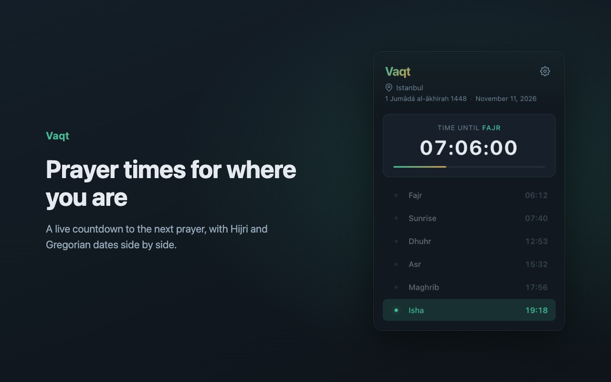
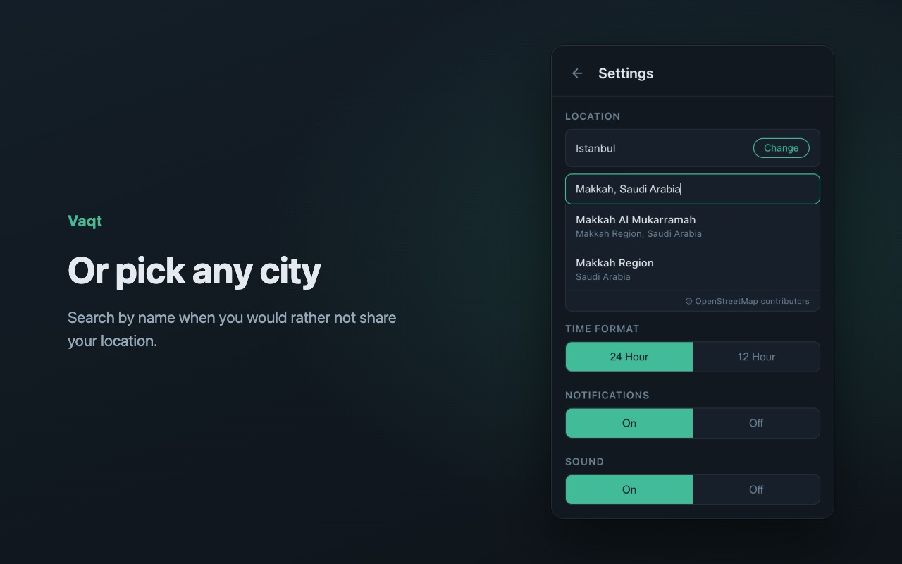
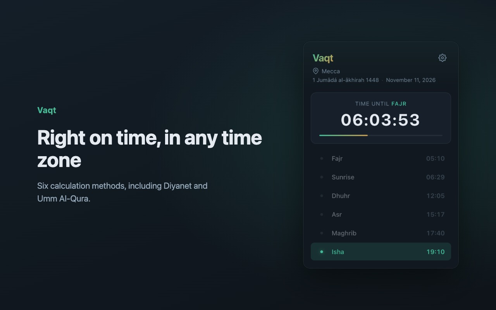

<p align="center">
  
</p>

<h1 align="center">Vaqt</h1>

<p align="center">
  Daily prayer times in your browser, with a live countdown to the next one.
</p>

<p align="center">
  <a href="https://chromewebstore.google.com/detail/vaqt-prayer-times/bhiafnmnhchmknldkdlmmjfmclkmnfmi"></a>
  
  
</p>

<p align="center">
  
</p>

Vaqt (Arabic and Turkish for "time") sits in your toolbar. Click it and you see today's five prayers plus sunrise, which one is next, and how long until it starts. It's free, needs no account, and has no servers of its own.

**Contents:** [For users](#for-users) · [FAQ](#faq) · [Privacy](#privacy) · [For developers](#for-developers) · [License](#license)

---

## For users

### Install

Get it from the [Chrome Web Store](https://chromewebstore.google.com/detail/vaqt-prayer-times/bhiafnmnhchmknldkdlmmjfmclkmnfmi), then pin it: click the puzzle icon in Chrome's toolbar and the pin next to Vaqt.

### First run

The first time you open Vaqt it asks where you are. You have two choices:

- **Share location**: Vaqt follows your device and updates when you move.
- **Search for a city**: type a city, press Enter, and pick it from the list. Vaqt keeps that city until you change it, even when you travel.

### What you see

- **The next prayer** and a live countdown, with a bar that fills as the time gets closer
- **All six times** for today: Fajr, Sunrise, Dhuhr, Asr, Maghrib and Isha. Past ones fade, the current one is highlighted
- **The Hijri and Gregorian dates** side by side
- **A notification** when each prayer starts (Sunrise is not a prayer, so it has none)

Times are always shown in the chosen city's own local time. If you pick Mecca while you're in Istanbul, you see Mecca's times, and the countdown still runs correctly from where you are.

<p align="center">
  
  
</p>

### Settings

Open them with the gear icon in the top right.

| Setting | Options | Default |
|---|---|---|
| Location | Your current location, or a city you search for | Current location |
| Calculation method | Diyanet (Türkiye), ISNA (North America), Muslim World League, Umm Al-Qura (Mecca), Egyptian General Authority, University of Karachi | Diyanet |
| Time format | 24 hour, 12 hour | 24 hour |
| Notifications | On, Off | On |
| Sound | On, Off | On |

## FAQ

**Vaqt's times differ from my local mosque by a few minutes. Why?**
Different authorities calculate prayer times differently, mostly for Fajr and Isha. Choose the method your community follows in Settings: Diyanet in Türkiye, ISNA in North America, Umm Al-Qura in Saudi Arabia, and so on.

**Location doesn't work.**
Vaqt can only read your location if both Chrome and your operating system allow it:

- **Chrome:** open `chrome://extensions`, find Vaqt, click **Details**, then **Site settings**, and set **Location** to **Allow**.
- **macOS:** System Settings → Privacy & Security → Location Services → turn on Google Chrome.
- **Windows:** Settings → Privacy & security → Location → allow apps, and allow your browser.

You can always skip this and search for your city instead.

**I don't get notifications.**
Check that **Notifications** is on in Vaqt's settings, then that your system lets Chrome show notifications (macOS: System Settings → Notifications → Google Chrome; Windows: Settings → System → Notifications). Focus or Do Not Disturb modes hide them too.

**Does Vaqt work offline?**
It needs an internet connection to load the day's times. It remembers your location, so it opens straight to your city when you're back online.

**Is Vaqt in Turkish or Arabic?**
Not yet; the interface is in English. Translations are welcome, see [Contributing](#contributing).

## Privacy

Vaqt has no servers of its own and tracks nothing. Your location and settings stay in your browser's local storage. To work, it sends:

- your coordinates and the calculation method to the [Aladhan API](https://aladhan.com/prayer-times-api), to get the prayer times
- your coordinates, or the city you typed, to [OpenStreetMap Nominatim](https://nominatim.org/), to show your city's name or find the city you searched for

Read the full [privacy policy](https://batuhan-bas.github.io/vaqt/privacy.html).

---

## For developers

Vaqt is plain HTML, CSS and JavaScript on Manifest V3. There is no build step, no framework and no dependencies.

### Run it locally

```bash
git clone https://github.com/batuhan-bas/vaqt.git
```

1. Open `chrome://extensions` and turn on **Developer mode**.
2. Click **Load unpacked** and select the `vaqt` folder.
3. After you change a file, click the reload icon on the Vaqt card and reopen the popup.

To debug, right-click the popup and choose **Inspect**; for the background worker, click **service worker** on the Vaqt card in `chrome://extensions`.

### Project structure

| File | What it does |
|---|---|
| `manifest.json` | Permissions, host permissions, CSP and entry points |
| `popup.html`, `popup.css`, `popup.js` | The popup: screens, rendering, countdown, city search and settings |
| `background.js` | Service worker: schedules a notification for each prayer and refreshes the times every hour |
| `shared.js` | Code used by both: prayer names, the API URL, and time zone handling |
| `offscreen.html`, `offscreen.js` | Reads geolocation for the service worker, which has no access to it |
| `privacy.html` | The privacy policy, also served on GitHub Pages |
| `_locales/en/messages.json` | Extension name and description |

### How it works

1. **Location.** The popup asks the service worker for a position. The worker opens an offscreen document, which calls `navigator.geolocation` and sends the coordinates back. A city picked by hand is saved with `locationSource: 'manual'`, and Vaqt never replaces it with GPS.
2. **Prayer times.** Vaqt calls Aladhan's `/v1/timings/{unix timestamp}` endpoint. Passing a timestamp instead of a date lets the API pick today's date in the city's own time zone.
3. **Time zones.** The API returns times like `05:12` in the city's local time. `prayerEpoch()` in `shared.js` turns them into absolute timestamps using `meta.timezone` and `Intl`, so countdowns and alarms are right even when the city is in another time zone. It handles daylight-saving changes too.
4. **Notifications.** The service worker creates one `chrome.alarms` alarm per remaining prayer, plus an hourly `refresh-times` alarm. Because Chrome can drop alarms when the browser restarts, the refresh alarm is recreated on every startup.
5. **City search.** Nominatim's public server allows at most one request per second and no search-as-you-type, so Vaqt searches only when the user presses Enter, throttles requests, and shows the OpenStreetMap credit.
6. **Storage.** Everything lives in `chrome.storage.local` under one `settings` object: `lat`, `lng`, `city`, `locationSource`, `method`, `timeFormat`, `notifications`, `sound`.

The calculation method is Aladhan's method id: `13` Diyanet, `2` ISNA, `3` MWL, `4` Umm Al-Qura, `5` Egyptian, `1` Karachi.

### Security

- The CSP allows scripts only from the extension itself: `script-src 'self'; object-src 'self'`.
- Text from APIs, such as place names, is always set with `textContent`, never `innerHTML`.
- Network access is limited to `api.aladhan.com` and `nominatim.openstreetmap.org`.

### Release

1. Bump `version` in `manifest.json`.
2. Package the extension files:

   ```bash
   zip -r vaqt.zip manifest.json background.js shared.js popup.html popup.js popup.css offscreen.html offscreen.js icons _locales
   ```

3. Upload the zip in the [Chrome Web Store Developer Dashboard](https://chrome.google.com/webstore/devconsole) and update the store's privacy answers if the permissions changed.

### Contributing

Issues and pull requests are welcome. Translations would help the most: the interface is English only, and adding Turkish and Arabic means moving the popup's strings into `_locales`. Please keep the extension dependency-free and the permissions as narrow as they are now.

## Credits

Prayer times from the [Aladhan API](https://aladhan.com/prayer-times-api). Place names © [OpenStreetMap contributors](https://www.openstreetmap.org/copyright).

## License

[MIT](LICENSE)
